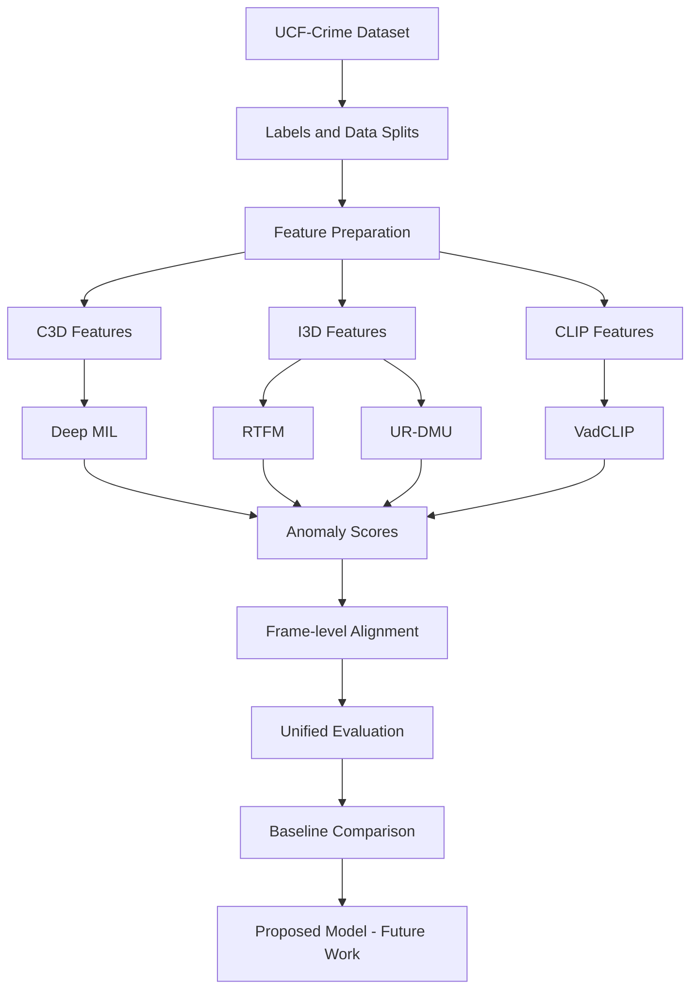
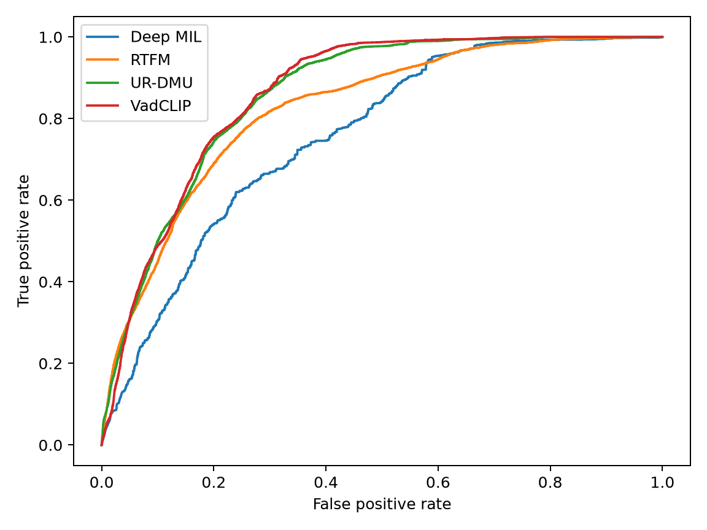
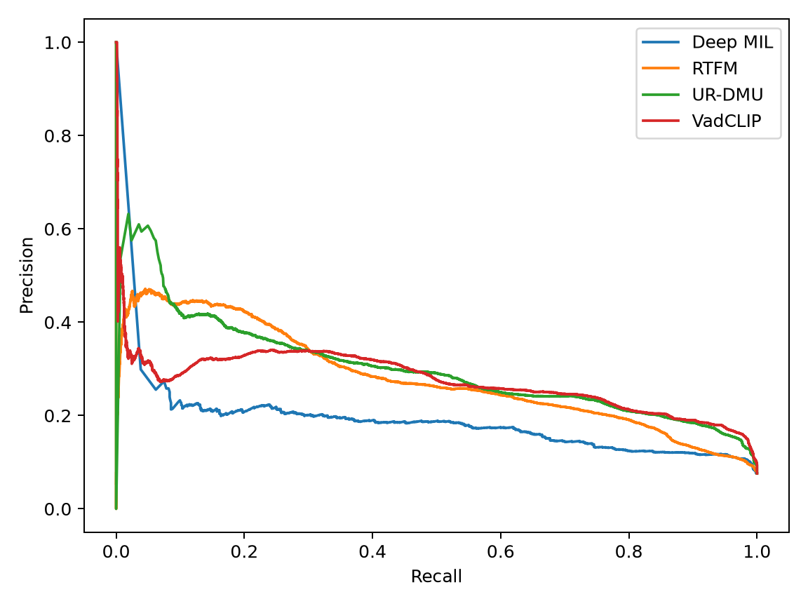

# Memory-Masked-EVT-MIL

## 1. Giới thiệu

Đề tài nghiên cứu phát hiện bất thường trong video với giám sát yếu (Weakly Supervised Video Anomaly Detection), kết hợp ngân hàng bộ nhớ thưa hóa (Sparse Memory Bank), cơ chế Memory-Guided Masking và lý thuyết giá trị cực trị (Extreme Value Theory - EVT) trong Multiple Instance Learning (MIL), dựa trên đặc trưng CLIP ViT-B/16.

### Thông tin đồ án

- Sinh viên: Lê Hoàng Danh
- MSSV: 235087
- Học phần: Đồ án 2
- Lĩnh vực: Artificial Intelligence, Computer Vision, Deep Learning
- Dataset: UCF-Crime

## 2. Mục tiêu nghiên cứu

- Nghiên cứu phương pháp phát hiện bất thường trong video với giám sát yếu.
- Xây dựng quy trình xử lý dữ liệu và đánh giá mô hình thống nhất.
- Thực nghiệm và so sánh các mô hình Baseline.
- Nghiên cứu biểu diễn đặc trưng video bằng CLIP.
- Xây dựng Sparse Memory Bank để biểu diễn các mẫu hành vi.
- Nghiên cứu cơ chế Memory-Guided Masking.
- Tích hợp Extreme Value Theory (EVT) vào Multiple Instance Learning.
- Đánh giá hiệu quả của mô hình đề xuất thông qua thực nghiệm và Ablation Study.

## 3. Tiến độ thực hiện

### Giai đoạn 1: Nghiên cứu và chuẩn bị môi trường

- [x] Nghiên cứu bài toán Video Anomaly Detection.
- [x] Nghiên cứu Weakly Supervised Learning và MIL.
- [x] Thu thập nguồn dữ liệu và tài liệu tham khảo.
- [x] Thiết lập môi trường Python, PyTorch và CUDA.
- [x] Khởi tạo Git Repository.
- [x] Chuẩn bị môi trường Local và Google Colab.

### Giai đoạn 2: Dữ liệu và Kiến trúc

- [x] Chuẩn bị bộ dữ liệu UCF-Crime và nhãn.
- [x] Chuẩn bị danh sách Train/Validation/Test.
- [x] Chuẩn bị đặc trưng C3D, I3D và CLIP.
- [x] Xây dựng pipeline thực nghiệm Baseline.
- [x] Huấn luyện Deep MIL.
- [x] Huấn luyện RTFM.
- [x] Huấn luyện UR-DMU.
- [x] Huấn luyện VadCLIP.
- [x] Inference trên 290 video kiểm thử.
- [x] Chuẩn hóa kết quả dự đoán và Ground Truth.
- [x] Xây dựng Unified Evaluation.
- [x] Đánh giá bốn mô hình Baseline.
- [x] Tổng hợp và so sánh kết quả thực nghiệm.

### Giai đoạn tiếp theo: Mô hình đề xuất

- [ ] Thiết kế kiến trúc Memory-Masked-EVT-MIL.
- [ ] Xây dựng Sparse Memory Bank.
- [ ] Xây dựng Memory-Guided Masking.
- [ ] Tích hợp EVT, POT và GPD.
- [ ] Thiết kế hàm Loss và chiến lược huấn luyện.
- [ ] Huấn luyện mô hình đề xuất.
- [ ] Thực hiện Ablation Study.
- [ ] So sánh với các mô hình Baseline.
- [ ] Hoàn thiện báo cáo đồ án.

## 4. Bộ dữ liệu

### UCF-Crime

UCF-Crime là bộ dữ liệu video phục vụ nghiên cứu phát hiện bất thường trong các tình huống thực tế.

- Video bình thường và bất thường.
- Nhãn mức video phục vụ Weakly Supervised Learning.
- Nhãn thời gian bất thường phục vụ đánh giá mức frame.
- Tập kiểm thử gồm 290 video.

### Phân chia tập kiểm thử

| Loại video | Số lượng |
|---|---:|
| Normal | 150 |
| Anomaly | 140 |
| Tổng cộng | 290 |

### Đặc trưng video

| Feature | Mô hình sử dụng |
|---|---|
| C3D | Deep MIL |
| I3D | RTFM, UR-DMU |
| CLIP | VadCLIP |
| CLIP ViT-B/16 | Mô hình đề xuất (dự kiến) |

### Nguồn dữ liệu

- [UCF-Crime Dataset](https://www.crcv.ucf.edu/projects/real-world/)
- [VadCLIP Repository](https://github.com/nwpu-zxr/VadCLIP)

Do dung lượng lớn, video gốc và các đặc trưng video không được lưu trực tiếp trên GitHub.

## 5. Pipeline thực nghiệm



## 6. Các mô hình Baseline

| Model | Feature | Trạng thái |
|---|---|---|
| Deep MIL | C3D | Completed |
| RTFM | I3D | Completed |
| UR-DMU | I3D | Completed |
| VadCLIP | CLIP | Completed |
| Memory-Masked-EVT-MIL | CLIP ViT-B/16 | Planned |

Các mô hình Baseline được đánh giá trên cùng tập kiểm thử và quy trình đánh giá thống nhất.

## 7. Cấu trúc dự án

```text
Memory-Masked-EVT-MIL/
├── data/
│   ├── annotations/
│   ├── splits/
│   │   ├── train.csv
│   │   ├── val.csv
│   │   └── test.csv
│   └── processed/
│       ├── c3d_features/
│       ├── i3d_features/
│       └── clip_features/
│
├── models/
│   └── baselines/
│       ├── mil_sultani/
│       ├── rtfm/
│       ├── ur_dmu/
│       └── vadclip/
│
├── checkpoints/
│   ├── deep_mil/
│   ├── rtfm/
│   ├── ur_dmu/
│   └── vadclip/
│
├── evaluation/
│   ├── evaluate_scores.py
│   ├── compare_models.py
│   └── plot_loss.py
│
├── results/
│   ├── mil_sultani/
│   ├── rtfm/
│   ├── ur_dmu/
│   ├── vadclip/
│   └── comparison/
│
├── notebooks/
├── scripts/
├── requirements.txt
├── .gitignore
└── README.md
```

Lưu ý: data/processed, checkpoints và các file dự đoán dung lượng lớn được lưu bên ngoài GitHub.

## 8. Cài đặt môi trường

### Yêu cầu

- Python 3.11 hoặc môi trường Python tương thích.
- NVIDIA GPU.
- NVIDIA Driver.
- PyTorch hỗ trợ CUDA.
- Git.
- NumPy.
- Pandas.
- OpenCV.
- Scikit-learn.
- Matplotlib.
- CLIP.

### Local Environment

Tạo môi trường Conda:

```bash
conda create -n Memory-Masked-EVT-MIL python=3.11 -y

conda activate Memory-Masked-EVT-MIL
```

Cài đặt PyTorch CUDA phù hợp tại:

https://pytorch.org/get-started/locally/

Cài đặt các thư viện:

```bash
pip install -r requirements.txt
```

Kiểm tra GPU:

```bash
python scripts/check_gpu.py
```

Kiểm tra CUDA trực tiếp:

```bash
python -c "import torch; print(torch.cuda.is_available())"
```

### Google Colab

Mở notebook:

```text
notebooks/01_setup_environment.ipynb
```

Chọn GPU Runtime và thực hiện các cell thiết lập môi trường.

### Lưu ý đối với VadCLIP

VadCLIP sử dụng phiên bản CLIP tùy chỉnh có hỗ trợ phương thức encode_token và Prompt Learning.

Thư viện tương thích được đặt tại:

```text
models/baselines/vadclip/clip/
```

Không thay thế bằng OpenAI CLIP tiêu chuẩn khi chạy inference VadCLIP.

## 9. Unified Evaluation

Chương trình đánh giá thống nhất:

```text
evaluation/evaluate_scores.py
```

Chức năng:

- Đọc anomaly scores từ các mô hình.
- Chuẩn hóa tên video.
- Kiểm tra số lượng video kiểm thử.
- Căn chỉnh điểm dự đoán và Ground Truth theo frame.
- Kiểm tra dữ liệu dự đoán không hợp lệ.
- Tính toán các chỉ số đánh giá.
- Lưu kết quả và dữ liệu phục vụ so sánh.

### Ví dụ đánh giá VadCLIP

```bash
python evaluation/evaluate_scores.py \
    --scores results/vadclip/video_scores.npz \
    --ann-txt data/annotations/Temporal_Anomaly_Annotation_for_Testing_Videos.txt \
    --videos /path/to/UCF_Crime \
    --out-dir results/vadclip/eval \
    --threshold 0.5 \
    --tail edge \
    --max-tail 16 \
    --temporal-map
```

Thay /path/to/UCF_Crime bằng đường dẫn dataset thực tế.

Chính sách căn chỉnh frame cần phù hợp với cách lấy mẫu đặc trưng của từng mô hình.

## 10. Các chỉ số đánh giá

| Metric | Description |
|---|---|
| ROC-AUC | Area Under the ROC Curve |
| AP | Average Precision |
| Accuracy | Frame-level Accuracy |
| Precision | Tỷ lệ dự đoán bất thường chính xác |
| Recall | Khả năng phát hiện frame bất thường |
| F1-score | Trung bình điều hòa Precision và Recall |
| FAR | False Alarm Rate |
| Binary Temporal mAP | Đánh giá định vị đoạn bất thường theo thời gian |

Các chỉ số Accuracy, Precision, Recall, F1-score và FAR được tính theo ngưỡng đánh giá thống nhất 0.5.

Binary Temporal mAP được sử dụng để đánh giá định vị bất thường nhị phân, không phải mAP phân loại theo từng nhóm hành vi.

## 11. Baseline Comparison

Chạy chương trình so sánh:

```bash
python evaluation/compare_models.py \
    --eval-dirs \
        "Deep MIL=results/mil_sultani/eval" \
        "RTFM=results/rtfm/eval" \
        "UR-DMU=results/ur_dmu/eval" \
        "VadCLIP=results/vadclip/eval" \
    --out-dir results/comparison
```

Chương trình kiểm tra tính đồng nhất của:

- Danh sách và thứ tự video.
- Số lượng frame.
- Ground Truth.
- Ngưỡng đánh giá.

### Bảng kết quả thực nghiệm

Xem kết quả đầy đủ tại:

[Baseline Comparison CSV](results/comparison/model_comparison.csv)

### ROC Curve



### Precision-Recall Curve



## 12. Sản phẩm Giai đoạn 2

| Thời gian | Nội dung | Sản phẩm |
|---|---|---|
| 01/12/2026 | Thu thập dữ liệu và nhãn | UCF-Crime và Annotation |
| 05/12/2026 | Tiền xử lý và chuẩn hóa dữ liệu | Features và Data Splits |
| 10/12/2026 | Xây dựng pipeline và Baseline | Source Code, Checkpoints và Evaluation |

Sản phẩm tổng thể:

- Dataset và Annotation.
- Bộ đặc trưng C3D, I3D và CLIP.
- Danh sách phân chia dữ liệu.
- Pipeline thực nghiệm.
- Source code của bốn mô hình Baseline.
- Trọng số mô hình đã huấn luyện.
- Bộ công cụ đánh giá thống nhất.
- Bảng Benchmark và biểu đồ so sánh.

## 13. Lưu trữ sản phẩm

### GitHub

Repository lưu trữ:

- Source code.
- Dataset annotations.
- Data splits.
- Evaluation scripts.
- Comparison scripts.
- Metrics.
- Biểu đồ thực nghiệm.
- Tài liệu hướng dẫn.

### Google Drive

Các sản phẩm có dung lượng lớn được lưu tại Google Drive:

**[Google Drive - Dataset, Features, Checkpoints and Results](https://drive.google.com/drive/folders/1MWfm92vi0_PDfCOZBkRAcbQYNJvppzwv)**

```text
DA2_235087_LEHOANGDANH_Memory-Masked-EVT-MIL/
├── 01_Dataset/
├── 02_Features/
├── 03_Checkpoints/
└── 04_Results/
```

Sau khi tải các file cần thiết, đặt chúng vào đúng vị trí tương ứng trong cấu trúc dự án.

## 14. Tài liệu tham khảo

1. Sultani et al. - Real-world Anomaly Detection in Surveillance Videos (CVPR 2018).
2. Tian et al. - Weakly-supervised Video Anomaly Detection with Robust Temporal Feature Magnitude Learning (ICCV 2021).
3. UR-DMU - Uncertainty-Regulated Dual Memory Units for Weakly Supervised Video Anomaly Detection (AAAI 2023).
4. VadCLIP - Adapting Vision-Language Models for Weakly Supervised Video Anomaly Detection (AAAI 2024).
5. Radford et al. - Learning Transferable Visual Models From Natural Language Supervision (ICML 2021).

## 15. Trạng thái dự án

Giai đoạn hiện tại: Hoàn thành thực nghiệm Baseline và chuẩn bị thiết kế mô hình đề xuất Memory-Masked-EVT-MIL.

Repository được phát triển phục vụ mục đích học tập và nghiên cứu khoa học.

---

**Author:** Lê Hoàng Danh

**Student ID:** 235087

**Project:** Đồ án 2 - Memory-Masked-EVT-MIL

**Year:** 2026
